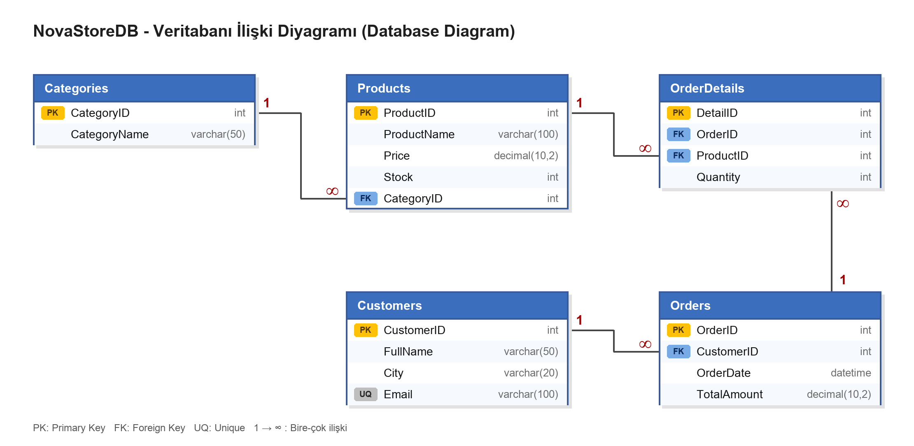

# NovaStore E-Ticaret Veri Yönetim Sistemi

SQL Server üzerinde geliştirilmiş, e-ticaret senaryolu bir veri tabanı projesi. Tablo tasarımı (DDL), örnek veri girişi (DML), raporlama sorguları (DQL), view ve yedekleme komutunu kapsar.

> Senaryo: Yeni kurulan "NovaStore" e-ticaret sitesinin veri tabanı yöneticisi (DBA) olarak ürünlerin, müşterilerin ve siparişlerin tutulacağı ilişkisel bir veri tabanı tasarlanır ve yönetim için gerekli raporlar SQL ile hazırlanır.

## Veri Tabanı Yapısı



| Tablo | Açıklama | Önemli kısıtlar |
|---|---|---|
| `Categories` | Ürün kategorileri | PK `CategoryID` (Identity), `CategoryName` NOT NULL |
| `Products` | Ürünler | PK `ProductID`, `Stock` varsayılan 0, FK → `Categories` |
| `Customers` | Müşteriler | PK `CustomerID`, `Email` UNIQUE |
| `Orders` | Siparişler | PK `OrderID`, `OrderDate` varsayılan `GETDATE()`, FK → `Customers` |
| `OrderDetails` | Sipariş kalemleri (ara tablo) | PK `DetailID`, FK → `Orders`, FK → `Products` |

İlişkiler: Categories 1–∞ Products, Customers 1–∞ Orders, Orders 1–∞ OrderDetails, Products 1–∞ OrderDetails.

## Örnek Veri

5 kategori, 12 ürün, 6 müşteri, 10 sipariş ve 19 sipariş detayı. Her siparişin `TotalAmount` değeri, detaylardaki (adet × ürün fiyatı) toplamıyla eşleşir.

## Sorgular

| # | Konu | Kullanılanlar |
|---|---|---|
| 3.1 | Stoğu 20'den az ürünler (azalan) | `WHERE`, `ORDER BY` |
| 3.2 | Hangi müşteri, hangi tarihte sipariş verdi | `INNER JOIN` |
| 3.3 | Ahmet Yılmaz'ın aldığı ürün, fiyat, kategori | 5 tablo `JOIN` |
| 3.4 | Kategori başına ürün sayısı | `GROUP BY`, `COUNT`, `LEFT JOIN` |
| 3.5 | Müşteri bazında ciro (çoktan aza) | `SUM`, `GROUP BY`, `ORDER BY` |
| 3.6 | Siparişin üzerinden geçen gün | `DATEDIFF`, `GETDATE` |
| 3.7 | Bonus: ortalama harcamanın üstündeki müşteriler | Alt sorgu (`Subquery`), `HAVING` |

Ayrıca `vw_SiparisOzet` view'ı (müşteri adı, sipariş tarihi, ürün adı, adet) ve `BACKUP DATABASE` komutu içerir.

## Çalıştırma

### SSMS ile (Windows)
`ImdatSonmez_NovaStore_Proje.sql` dosyasını açıp çalıştırın. Script, `NovaStoreDB` varsa silip yeniden oluşturur.

> **Backup notu:** Son komut yedeği `C:\Yedek\` klasörüne alır. Bu klasör yoksa o komut hata verir; önce klasörü oluşturun. Diğer her şey bundan bağımsız çalışır.

### Docker ile (Mac / Linux / Windows)
```bash
# SQL Server 2022 konteyneri (şifreyi kendiniz belirleyin)
docker run --platform linux/amd64 -e ACCEPT_EULA=Y -e 'MSSQL_SA_PASSWORD=<GucluSifre>' \
  -p 1433:1433 --name novastore-sql -d mcr.microsoft.com/mssql/server:2022-latest

# Script'i konteynere kopyalayıp çalıştırın
docker cp ImdatSonmez_NovaStore_Proje.sql novastore-sql:/tmp/p.sql
docker exec novastore-sql /opt/mssql-tools18/bin/sqlcmd -C -S localhost -U sa -P '<GucluSifre>' -f 65001 -W -i /tmp/p.sql
```

Linux'ta `C:\Yedek\` yolu olmadığı için script'in sonundaki backup komutu hata verir; bu beklenen bir durumdur. Aynı komut `/var/opt/mssql/backup/NovaStoreDB.bak` gibi bir Linux yoluyla sorunsuz çalışır.

## Dosyalar

| Dosya | İçerik |
|---|---|
| `ImdatSonmez_NovaStore_Proje.sql` | Tüm DDL, veri, sorgular, view ve backup |
| `ImdatSonmez_NovaStore_Proje.docx` | Kod, sonuç görselleri ve açıklamalar |
| `ImdatSonmez_NovaStore_Proje.png` | İlişki diyagramı |
| `ekran_goruntuleri/` | Tablo ve sorgu sonuç görselleri |

## Notlar
- Veri tabanı `Turkish_CI_AS` collation ile oluşturulur; `varchar` kolonlarda Türkçe karakterler (ş, ğ, İ) bozulmaz.
- Sonuç görselleri, Microsoft SQL Server 2022'den alınan gerçek çıktılardan üretilmiş SSMS benzeri görsellerdir; SSMS ekran görüntüsü değildir.
- Script UTF-8 (BOM'lu) kaydedilmiştir.

Hazırlayan: İmdat Sönmez
